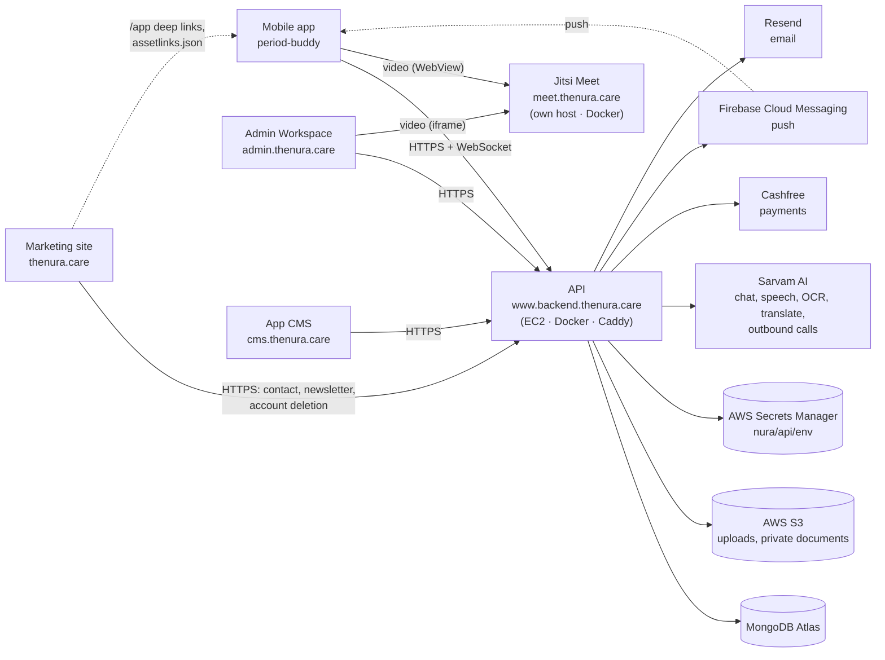

# The Nura — System Architecture

The one picture of how the whole product fits together: five repos, one API,
one database. **Last checked against the code and the live AWS account:
2026-09-30.**

This is the only system-wide architecture doc. The other four repos link here
instead of keeping their own copy. For per-file detail, read each repo's
`CLAUDE.md` / `README.md`; if this page and a `CLAUDE.md` ever disagree, trust
the `CLAUDE.md` and fix this page.

## The five repos

| Repo (GitHub) | Local folder | What it is | Stack | Runs at |
|---|---|---|---|---|
| [`period-buddy`](https://github.com/utkarshpayal/period-buddy) | `The-Nura-App` | The mobile app (Android, iOS, web) | Expo SDK 54, Expo Router 6, React Native, TypeScript, NativeWind | Play Store (`com.uvin124.thenura`); builds via EAS |
| [`period-buddy-be`](https://github.com/utkarshpayal/period-buddy-be) | `The-Nura-Backend` | The one API every client talks to | Node.js, Express, Mongoose, plain JS | `https://www.backend.thenura.care` (AWS EC2, Mumbai) |
| [`period-buddy-content`](https://github.com/utkarshpayal/period-buddy-content) | `The-Nura-Admin-Website` | Admin Workspace (staff), clinician portal (doctors), People & Letters (HR) | React 18, TypeScript, Vite | `https://admin.thenura.care` (Vercel) |
| [`the-nura-care-cms`](https://github.com/utkarshpayal/the-nura-care-cms) | `The-Nura-CMS` | App CMS: remote layout, feature launches, banners, theme, update prompts | React, TypeScript, Vite | `https://cms.thenura.care` (Vercel) |
| [`The-Nura-website`](https://github.com/utkarshpayal/The-Nura-website) | `The-Nura-Marketing-Website` | Public site, legal pages, account deletion, deep-link bounce page | React 19, Vite | `https://thenura.care` (Vercel) |

All five are private repositories.

## System diagram



Rules that hold everywhere:

- **Only the API touches the database and the third-party services.** No
  client talks to MongoDB, S3, Sarvam, Cashfree or Resend directly. The one
  exception is push: the app registers its own FCM/APNs token and receives
  pushes straight from Firebase; the API is what sends them.
- **Every video call** (doctor consultations, Period Buddy calls) runs on a
  separate self-hosted Jitsi server; there is no other video path. Clients
  join it directly, but only with a short-lived token the API signs after
  checking the booking (patient or assigned doctor, paid, inside the join
  window) or the buddy pairing. The signing secret is shared only by the API and the Jitsi host
  (backend `infra/jitsi/README.md`).
- **One database** (MongoDB Atlas) serves every client. The admin portal and
  the CMS write content and config; the app reads it.
- **Staff and users are the same `User` collection**, told apart by `role`.
  Staff roles and their permissions live in the backend's
  `src/config/permissions.js`; the Admin Workspace and the CMS both sign in
  through `/api/auth/login` and read permissions from `/api/admin/me`.

## Who can use which portal

| Role (`User.role`) | Admin Workspace | CMS |
|---|---|---|
| `admin` (Super Admin) | Everything | Edit + publish |
| `app_super_admin` | App side: users, push, subscriptions, analytics, schemes, staff | Edit + publish |
| `app_admin` | App side, read-mostly | View only |
| `content_super_admin`, `content_admin` | Content (blogs, guides, videos, Q&A), approvals for super | No access |
| `clinical_admin` | Doctors | No access |
| `doctor` | Clinician portal | No access |
| `user`, `partner` | No access (mobile app only) | No access |

New staff are invited from Admin Workspace → Staff (an email with a
set-password link). An address that already has an app account can't be
invited; its role has to be changed in the database.

## The mobile app (`period-buddy`)

- **Routing:** Expo Router file-based routes. `(tabs)/` is signed-out
  (login, signup, partner connect), `(app)/(dashboard)/` the owner's tab bar
  (Home, Tracker, Community, Profile), `(app)/(partner-view)/` a connected
  partner's read-only view, and every feature is one screen under `(app)/`.
  Home stays short; features are grouped behind three hubs (Care & Insights,
  Wellness & Support, Explore).
- **Data layer:** one file, `lib/api/`, owns every HTTP call (see
  [API_REFERENCE.md](./API_REFERENCE.md)). Every failure is a typed
  `ApiError`; a 401 signs the user out globally; writes emit data-change
  topics so other mounted screens refetch (`lib/data-sync.ts`).
- **State:** React context providers (theme, Gen Z mode, auth, app lock, app
  config, app state, partner-view state), no Redux.
- **Remote layout:** `components/app-config.tsx` loads `GET /api/app-config`
  (built-in defaults → cached copy → fresh fetch) so the CMS can move, hide,
  launch or pause features, and show banners and update prompts, without a
  release.
- **Realtime:** one shared WebSocket (`hooks/useRealtimeSocket.ts`),
  reference-counted per room (`community`, `partner_<id>`, `buddy_<key>`,
  `consultation_<id>`, and the auto-joined `user_<id>`).
- **On-device storage:** the session token and health-related caches (the
  onboarding draft) are in the OS keystore (`lib/sessionStore.ts`,
  `lib/secureStorage.ts`). AsyncStorage holds only non-secret things: the
  profile, theme, cached app config, cosmetic preferences.
- **Config:** `app.json` is the source of truth. The API URL and the Google
  OAuth client IDs come from `EXPO_PUBLIC_*` env vars, falling back to
  `app.json` → `extra` (`apiBaseUrl`, `googleClientIds`).

## The API (`period-buddy-be`)

- **Layering:** `routes/` → `middleware/` (auth, permissions, feature gate,
  rate limits) → `controllers/` → `models/` (Mongoose), with shared logic in
  `utils/`.
- **Auth:** JWTs backed by revocable `UserSession` rows (log out one device or
  everywhere). Staff and doctors add a second sign-in step (authenticator app,
  recovery code or emailed code). Staff may use an `HttpOnly` cookie instead of
  a bearer token.
- **Paywall:** a global feature gate driven by one registry file
  (`config/subscriptionRouteRegistry.js`) answers `402 FEATURE_LOCKED` before a
  controller runs.
- **Scheduled jobs:** daily reminders and check-in calls tick in-process
  (`utils/inProcessScheduler.js`); account purge and data retention run from
  their own runners started in `index.js`. Keep the API to one instance, or
  jobs double-fire and WebSocket rooms split.
- **AI:** Sarvam AI for chat, speech, OCR, translation and outbound phone
  calls, gated by each person's AI consent. See the backend's
  `docs/AI_ML_OVERVIEW.md`.

## Deployment

| Piece | How it ships |
|---|---|
| API | Merge to `main` → CodePipeline **`the-nura-care-be`** → CodeBuild (lint, test, Docker image to ECR `nura-api`) → CodeDeploy to EC2 `Nura-Backend` (ap-south-1). Environment comes from Secrets Manager `nura/api/env`; changing it needs a new pipeline run. Failed health checks roll back. Details: backend `docs/INFRASTRUCTURE.md`. |
| Mobile app | `eas build` (profiles in `eas.json`), then Play Store. Native changes need a new build; JS-only and CMS changes don't. |
| Admin, CMS, marketing site | Vercel, from `main`. Each needs its `VITE_*` API URL set in Vercel. |
| Jitsi (video) | Its own Ubuntu host (Lightsail or EC2, never the API server), official `docker-jitsi-meet` pinned in backend `infra/jitsi/install.sh`. The API needs its `JITSI_*` values; until then video calls are unavailable. |

## Security

Everything about how data is protected (encryption, sessions, staff access,
retention, incident response) is in one place: the backend's
[`docs/SECURITY.md`](https://github.com/utkarshpayal/period-buddy-be/blob/main/docs/SECURITY.md).
The app-side details are in [security-implementation.md](./security-implementation.md).
The public, plain-language version is `https://thenura.care/security`, which
must never claim more than `SECURITY.md` does.

## Data flow: logging a day

```
User taps "Log period"
  → DayDetailsModal → cycleApi.saveLog()                    (lib/api/)
  → POST /api/cycle/log   Authorization: Bearer <jwt>
  → auth middleware: token → live UserSession
  → feature gate: route not gated
  → cycleController: derive cycle day/phase, upsert CycleLog (note field encrypted),
    award tokens once per new day, recompute streak
  → response → app emits the "cycle" topic → Home, Tracker and Calendar refetch
```

## Data flow: a Nura AI message

```
questionAnswerApi.sendSessionMessage()
  → POST /api/questions/sessions/:id/messages
  → AI consent check (403 AI_CONSENT_REQUIRED if AI is off)
  → companionChat: urgent-safety check → topic classifier → knowledge base → Sarvam AI → local fallback
  → messages saved encrypted on the session
```

## Related docs

- [README.md](./README.md): index of this repo's docs, and links to every repo's docs.
- [API_REFERENCE.md](./API_REFERENCE.md): every endpoint the app calls.
- [SETUP.md](./SETUP.md): run the app and the backend locally.
- Backend `docs/INFRASTRUCTURE.md`, `docs/SECURITY.md`, `docs/API_DOCUMENTATION.md`, `docs/AI_ML_OVERVIEW.md`.
- CMS `docs/launch-states.md`: the launch-state contract between CMS, API and app.
